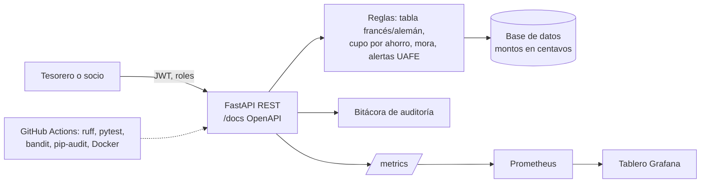

# Caja de Ahorro Comunitaria API

🇬🇧 [English](README.md) · 🇪🇨 **Español**

> **Caso de estudio en 1 minuto**

**Problema de negocio.** Muchas cajas de ahorro comunitarias de Ecuador todavía llevan socios, ahorros y préstamos en cuadernos o en Excel. Eso significa tablas de amortización hechas a mano, mora detectada tarde y ningún rastro de los movimientos de efectivo que pide el reporte de la UAFE.

**Solución.** Una API REST pequeña y segura que hace el trabajo diario de la caja: socios y aportes, depósitos y retiros, préstamos con su tabla, mora, alertas UAFE y bitácora de auditoría.



**Impacto medido**
- **17 pruebas automáticas** (8 de amortización, 9 del flujo de la API) en cada push, más ruff, bandit y pip-audit; el CI tarda menos de un minuto ([workflow](https://github.com/COMPUMAX-EC/caja-ahorro-api/actions/workflows/ci.yml)).
- **Cada tabla de amortización en centavos enteros**, método francés y alemán, para que los totales nunca se desvíen por redondeo.
- **Alertas UAFE incluidas:** movimientos desde USD 10.000, varios que suman ese monto en 30 días y posible fraccionamiento de efectivo en 7 días.
- **Cada movimiento de dinero queda auditado** con quién lo hizo.
- Aún sin medir: ninguna caja lo usa en producción; el despliegue en Cloud Run está listo pero no activado.

---


API REST de demostración para una **caja de ahorro y crédito comunitaria** de Ecuador (sector financiero popular y
solidario, registrado en la SEPS). Resuelve lo que muchas cajas todavía llevan en cuadernos o en Excel:

- **Socios y aportes**: registro de socios, certificados de aportación y estado de cuenta.
- **Ahorros**: depósitos y retiros de ventanilla, con control de saldo.
- **Préstamos**: simulación y **tabla de amortización** con método **francés** (cuota fija) o **alemán** (capital fijo),
  aprobación con **encaje** (hasta 3 veces lo ahorrado y aportado) y desembolso al ahorro del socio.
- **Mora**: días de atraso y recargo por cuota vencida, cobro de cuotas e **índice de morosidad** de la cartera.
- **Alertas**: operaciones para el RESU de la **UAFE** (desde USD 10.000, o varias de un mismo socio que juntas llegan a
  ese valor en 30 días, en efectivo o no), posible fraccionamiento en efectivo en 7 días y retiros altos.
- **Auditoría**: cada operación que mueve dinero queda registrada con quién la hizo.

> Es una demo con datos de prueba, pensada como proyecto de portafolio. No está en producción en ninguna institución.

## Qué muestra

| Habilidad | Dónde |
|---|---|
| Dominio financiero (ahorro y crédito) | `app/amortizacion.py`, reglas de encaje, mora y UAFE en `app/main.py` y `app/alertas.py` |
| APIs REST | FastAPI con documentación OpenAPI en `/docs` |
| Seguridad | JWT de 15 minutos, roles (tesorero/socio), claves con PBKDF2 (600.000 iteraciones), límite de intentos de inicio de sesión, cabeceras de seguridad, montos en centavos enteros, consultas parametrizadas, bandit y pip-audit en CI |
| CI/CD | GitHub Actions: ruff, pytest, bandit, pip-audit, construcción y prueba de la imagen Docker, despliegue automático |
| Nube pública | Google Cloud Run (escala a cero), Secret Manager y Workload Identity Federation (sin llaves en el repositorio) |
| Observabilidad | Métricas Prometheus en `/metrics` y tablero de Grafana listo (peticiones, errores, latencia p95, operaciones, alertas, morosidad) |

## Probarlo

```bash
python -m venv .venv && .venv/Scripts/activate   # en Linux/macOS: source .venv/bin/activate
pip install -r requirements.txt pytest httpx
pytest -q
```

Con Docker (API, Prometheus y Grafana):

```bash
docker compose up --build
```

- API y documentación: <http://localhost:8080/docs> (usuario `tesorero`, clave `clave-local-tesorero`)
- Grafana: <http://localhost:3000>, tablero *Caja de ahorro — operación*

Flujo de ejemplo en `/docs`: `POST /auth/token` → `POST /socios` → `POST /movimientos` (depósito y aporte) →
`POST /prestamos/simular` → `POST /prestamos` → `POST /prestamos/{id}/aprobar` → `GET /prestamos/{id}` →
`GET /reportes/cartera`.

## Desplegar

Ver [docs/deployment.md](docs/deployment.md): Cloud Run con la capa gratuita y alerta de presupuesto.

## Reglas configurables

Las define la asamblea de cada caja; aquí son variables de entorno (`app/config.py`): aporte mensual, veces el ahorro que
se puede prestar, tasa de mora y umbral de retiro alto.

Licencia: MIT.
