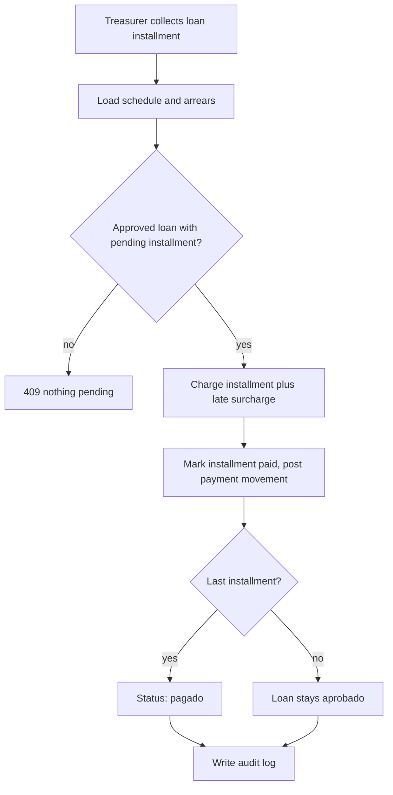

# Installment collection

## Purpose
Collect the oldest pending installment at the counter, including the late surcharge, and close the loan after the last one.

## Roles
- **Treasurer**: collects (`POST /prestamos/{pid}/pagar`).

## Flow

## Procedure
1. The API loads the schedule and computes days late and the surcharge (`TASA_MORA_ANUAL` on the overdue installment).
2. It picks the oldest unpaid installment. If none, or the loan is not `aprobado`, it returns 409.
3. The amount charged is installment plus surcharge, stored in cents as a cash `pago_prestamo` movement.
4. When the last installment is paid the loan becomes `pagado`.
5. The audit log records loan, installment number and amount.

## Controls
| Control | Where |
|---|---|
| Installments are collected in order | `pagar_cuota` (oldest unpaid) |
| Late surcharge computed by the system | `detalle_prestamo` |
| Delinquency ratio reported | `GET /reportes/cartera` (overdue principal / pending principal) |

## Audit evidence
`auditoria` entry `pago_cuota`; `movimientos` row `pago_prestamo`; `cuotas.pagada = 1`.
