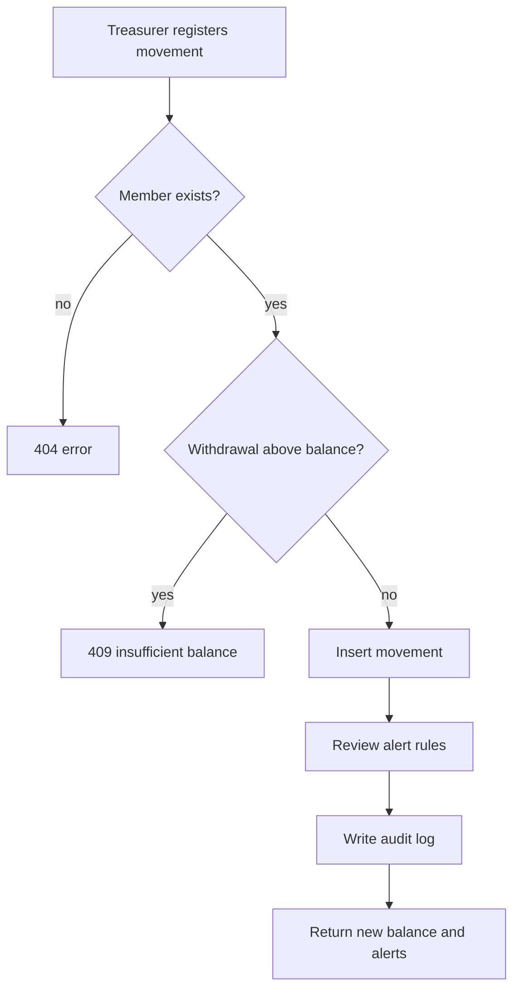

# Savings deposit and withdrawal

## Purpose
Record cash or non-cash deposits and withdrawals on a member's savings account, keeping the balance non-negative and
flagging unusual operations for review.

## Roles
- **Treasurer**: registers the movement (`POST /movimientos`). Members cannot post movements.

## Flow

## Procedure
1. The treasurer identifies the member and the amount, and whether it is cash.
2. The API checks the member exists and, for withdrawals, that the amount does not exceed the savings balance.
3. The movement is stored in integer cents with the treasurer's id.
4. Alert rules run on the new movement (UAFE RESU threshold, 30-day accumulation, structuring in 7 days, large withdrawal).
5. An audit entry is written and the new balance and any alerts are returned. Alerts do not block the operation.

## Controls
| Control | Where |
|---|---|
| Only the treasurer role posts movements | `app/main.py` (`Tesorero` dependency) |
| No negative savings balance | `registrar_movimiento` (409 on overdraft) |
| UAFE RESU alerts, structuring and large-withdrawal alerts | `app/alertas.py` |
| Amounts as integer cents | `cents()` in `app/main.py` |

## Audit evidence
`auditoria` entry per movement (who, action, movement id, member, amount); `alertas` rows for triggered rules.
