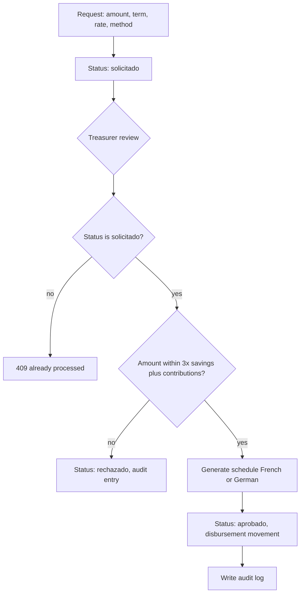

# Loan origination and disbursement

## Purpose
Take a loan request, check it against the savings-backed limit, generate the amortization schedule and credit the
disbursement to the member's savings.

## Roles
- **Member or treasurer**: submits the request (`POST /prestamos`); only the treasurer can request on behalf of another member.
- **Treasurer**: approves or rejects (`POST /prestamos/{pid}/aprobar`).

## Flow

## Procedure
1. The request is stored with status `solicitado` (amount up to 12 digits, term 1-60 months, annual rate up to 30%).
2. The treasurer reviews it. Only a `solicitado` loan can be approved; any other status returns 409.
3. The API compares the amount with `3 x (savings balance + total contributions)`. Above the limit the loan is `rechazado` and the reason is logged.
4. Otherwise the installments are generated (French = fixed installment, German = fixed principal), the loan becomes `aprobado` and a `desembolso` movement is posted.
5. The audit log records the decision with the treasurer's id.

## Controls
| Control | Where |
|---|---|
| Disbursement only after treasurer approval | `aprobar` (Tesorero dependency, status check) |
| Savings-backed limit | `aprobar`, `config.VECES_AHORRO_PRESTAMO` |
| Rate ceiling 30% and term 1-60 months | `Solicitud` model |
| No double approval | status must be `solicitado` |

## Audit evidence
`auditoria` entries `solicitar_prestamo`, `aprobar_prestamo` or `rechazar_prestamo`; `cuotas` rows; `desembolso` movement.
